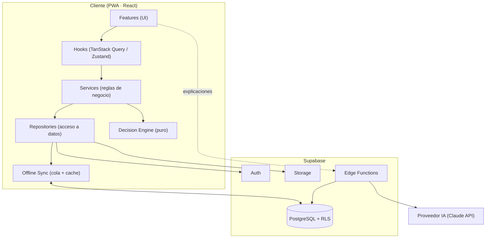
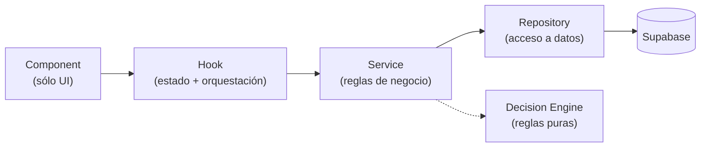
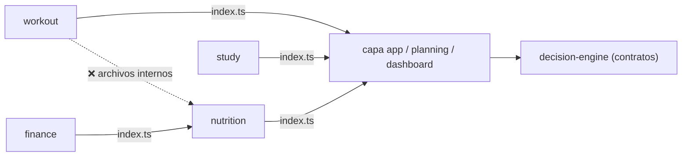

# 02 · Arquitectura

Este documento define **cómo se organiza Nexus y cómo fluyen los datos**. Es la
referencia que toda implementación debe respetar. La estructura física de
carpetas que materializa esta arquitectura está en
[03 · Estructura de carpetas](./03-estructura-de-carpetas.md).

## Principios que guían la arquitectura

Se aplican de forma permanente (constitución): **SOLID, DRY, KISS, YAGNI, Clean
Architecture, Composition over Inheritance, Single Source of Truth, Offline First,
Mobile First**. En caso de conflicto manda el orden de prioridad:
correctitud → arquitectura → legibilidad → escalabilidad → mantenibilidad →
seguridad → performance → UX → velocidad.

## Vista de alto nivel

Nexus es una **PWA de una sola página** (React) que consume **Supabase** como
backend, con dos piezas de inteligencia claramente separadas: el **Decision
Engine** (reglas, determinista) y la **capa de IA** (interpretación).

## Arquitectura por capas (dentro de cada feature)

El flujo de datos es **unidireccional y estricto**. Un componente nunca habla con
Supabase directamente; siempre atraviesa las capas. Ver
[ADR-0001](./adr/0001-arquitectura-por-capas.md).

### Responsabilidad de cada capa

| Capa                | Sí hace                                                                                    | No hace                                                              |
| ------------------- | ------------------------------------------------------------------------------------------ | -------------------------------------------------------------------- |
| **Component**       | Mostrar información, capturar interacción.                                                 | Reglas de negocio, cálculos pesados, consultas, mutaciones directas. |
| **Hook**            | Conectar UI y negocio; exponer estado (loading/error/data); usar TanStack Query / Zustand. | Renderizar JSX; contener reglas de negocio.                          |
| **Service**         | Reglas de negocio del dominio; orquestar repositorios; invocar al Decision Engine.         | Acceder a Supabase directamente; contener UI; conocer React.         |
| **Repository**      | Leer/escribir en Supabase (o en la cola offline); mapear filas ⇄ modelos.                  | Reglas de negocio; decisiones.                                       |
| **Decision Engine** | Recibir contexto, aplicar reglas, devolver recomendaciones.                                | UI, acceso a BD, dependencia de IA o de React.                       |

**Regla de oro de dependencias:** una capa sólo conoce la que tiene inmediatamente
debajo. El `Component` no importa el `Repository`; el `Service` no importa React.

### Una consulta que puede crecer se pide por páginas

**Supabase corta en mil filas y no lo dice.** No hay error ni aviso: la consulta
parece haber ido bien y faltan datos. Pedir `.limit(5000)` o `.range(0, 4999)`
no lo levanta — es un tope del servidor.

Ya había pasado: las porciones de comida de ciento ochenta días eran 1.048 y
llegaban 1.000, **14.323 kcal que no contaban en el panel**, un 5,4 %.

Por eso **toda consulta acotada sólo por el tiempo o por el uso** —las porciones
de las comidas, las series de los entrenamientos, los vasos de agua— pasa por
`fetchAllRows` de `core/supabase`, que pide páginas hasta que una vuelve
incompleta. Con menos de mil filas es **una sola consulta**, igual que sin él.

Las acotadas por algo pequeño y conocido —las rutinas de alguien, sus cuentas,
sus categorías— no lo necesitan.

## Independencia entre features

- Cada feature es **autónoma** y expone su API pública mediante un `index.ts`
  (barrel). El resto del sistema **sólo** importa desde ese barrel.
- **Prohibido** importar archivos internos de otra feature
  (`features/nutrition/services/…` desde `features/workout`). Si algo debe
  compartirse, se promueve a `shared/` (si es genérico) o se comunica vía
  contratos del `Decision Engine` / capa de aplicación.
- Esto mantiene **bajo acoplamiento y alta cohesión**: una feature puede evolucionar
  sin arrastrar a las demás. Se aplica con reglas de ESLint (`no-restricted-imports`).

### Un dominio puede depender de otro, pero sólo en un sentido

Lo habitual es que quien consume a varios dominios sea una feature compositora
(`dashboard`, `planning`). **`finance → nutrition` es el primer caso
de dominio a dominio**, y se permite con tres condiciones:

1. **Sólo por el barrel.** Lo hace cumplir ESLint (`@/features/*/*` está
   prohibido), no la buena voluntad.
2. **Un solo sentido, sin ciclos.** `finance` conoce a `nutrition`; `nutrition`
   no sabe que `finance` existe. También lo fija ESLint, con una regla que impide
   el import de vuelta.
3. **Contrato explícito y mínimo.** Cruzan la frontera un tipo (`FoodPurchase`),
   una mutación (`useRepriceFoods`) y un bloque de interfaz
   (`FoodPurchaseFields`). Finanzas pone el **cuándo** —apuntar un gasto— y
   nutrición el **cómo**: qué es una porción y qué se escribe en `foods`.

El motivo es de producto: apuntar el mercado tiene que dejar los precios al día
sin obligar a repetir el registro en dos sitios. Sin este puente, el precio por
porción —la base de la nutrición económica— envejece hasta volverse ficción.

### Los tres hooks que expone un dominio

Cada dominio publica lo suyo en tres formas, según quién lo consuma. La regla
común: **el dominio decide cómo se cuenta lo suyo**, y quien lo consume no
recalcula nada.

| Hook            | Devuelve                     | Lo consume      |
| --------------- | ---------------------------- | --------------- |
| `useXSummary()` | frases ya formadas           | Hoy             |
| `useXContext()` | datos del día, sin formatear | Decision Engine |
| `useXSeries()`  | serie diaria de un rango     | Dashboard       |

Las features que **componen** (`planning`, `dashboard`) no tienen repositorio
propio: si lo tuvieran, conocerían las tablas de los seis dominios y romperían
este aislamiento. Ver [ADR-0006](./adr/0006-analytics-agrega-en-el-cliente.md).

## El Decision Engine

Es uno de los módulos más importantes y **completamente independiente** del resto
(sin React, sin Supabase, sin IA). Vive en `src/decision-engine/`. Ver
[ADR-0002](./adr/0002-decision-engine-independiente.md) y
[06 · Decision Engine e IA](./06-decision-engine-e-ia.md).

- **Entrada:** un `DailyContext` normalizado (snapshot de datos del usuario) que
  arman los services de cada feature.
- **Salida:** `Recommendation[]` (acciones sugeridas con motivo, datos y prioridad).
- **Propiedades:** determinista, puro, versionado y 100% testeable en aislamiento.
- **Dirección de dependencia:** las features dependen de los **contratos** del
  motor; el motor **no** depende de ninguna feature.

## La capa de IA

Se sitúa **por encima** del Decision Engine. Su función es **interpretar,
explicar, resumir y responder**, nunca ejecutar lógica crítica ni modificar datos.
El sistema debe funcionar completo aunque la IA se desactive
([ADR-0003](./adr/0003-ia-como-capa-de-interpretacion.md)).

- Se implementa como la feature `assistant`, que llama a un `AiService`.
- El `AiService` invoca una **Edge Function** (`ai-assistant`) que guarda la API
  key del proveedor y llama al modelo. La clave nunca toca el cliente.

## Autenticación y protección de rutas

La identidad es **infraestructura** (`core/auth/`); las pantallas de auth son la
feature `features/auth/`. Las **guardas de ruta** viven en `app/router/` porque
conocen el mapa de rutas.

- **Supabase Auth** gestiona sesión, persistencia y refresco.
- `AuthProvider` mantiene la sesión y escucha sus cambios; `useAuth` la expone con
  las acciones `signIn` / `signUp` / `signOut` / `requestPasswordReset` /
  `updatePassword`.
- El router se divide en **públicas** (`RedirectIfAuth`: si hay sesión, va al
  dashboard) y **protegidas** (`RequireAuth` → `AppShell`: sin sesión, va a login).
- La protección en el cliente es **UX**; los datos siguen protegidos por **RLS**
  en la base de datos (defensa real, ver [12 · Seguridad](./12-seguridad.md)).

## Gestión de estado

Cuatro tipos de estado, cada uno con su herramienta. **Nunca se duplica ni se
sincroniza manualmente.** Detalle de reglas en
[07 · Convenciones de código](./07-convenciones-de-codigo.md#estado).

| Tipo de estado    | Herramienta     | Ejemplo                                                 |
| ----------------- | --------------- | ------------------------------------------------------- |
| **Server state**  | TanStack Query  | Rutinas, comidas, sesiones (datos de Supabase).         |
| **UI global**     | Zustand         | Tema, sidebar abierta, filtros globales.                |
| **Formularios**   | React Hook Form | Alta de comida, registro de sueño.                      |
| **Validación**    | Zod             | Esquemas compartidos entre formulario, service y tipos. |
| **Local efímero** | `useState`      | Estado de un acordeón, hover, etc.                      |

### Regla: lo que devuelve una consulta tiene que sobrevivir a JSON

Nada de `Map`, `Set`, `Date` ni instancias de clase en el `data` de una
`useQuery`. Sólo objetos planos, arrays y primitivas.

**No es purismo, es una consecuencia de persistir la caché**
([ADR-0007](./adr/0007-cache-persistente-en-localstorage.md)): se guarda en
`localStorage` con `JSON.stringify`. Un `Map` se serializa como `{}` y vuelve
como un objeto pelado.

Costó una pantalla rota. `useRepeatableMeals` devolvía un `ReadonlyMap` y
Nutrición reventaba con `repeatable?.get is not a function` **sólo al rehidratar
la caché** — nunca en la primera carga, que es cuando se prueba. Lo fija un test
que hace ida y vuelta por JSON sobre el resultado del servicio.

## Flujo de datos de ejemplo (registrar una serie de gimnasio)

1. El usuario pulsa "Guardar serie" en un `Component`.
2. El `Component` llama a `useLogSet()` (`Hook`), que expone una mutación de
   TanStack Query.
3. La mutación invoca `WorkoutService.logSet(input)` que valida con Zod y aplica
   reglas (p. ej. marcar la sesión como `in_progress`).
4. El service llama a `WorkoutRepository.insertSet(...)`.
5. El repository escribe en Supabase **o**, si no hay conexión, encola la mutación
   (offline). TanStack Query actualiza la cache optimista.
6. Al recuperar conexión, la cola se sincroniza (ver [13 · Offline y PWA](./13-offline-y-pwa.md)).

## Manejo de errores (visión general)

Toda operación contempla **loading, success, error, empty y offline**. Los errores
se capturan en la capa de hook/service, se traducen a mensajes **humanos** (nunca
técnicos) y se registran cuando aportan valor. Existe un `ErrorBoundary` global y
`error handling` por feature. Detalle en [12 · Seguridad](./12-seguridad.md) y
[07 · Convenciones](./07-convenciones-de-codigo.md).

## Offline-first (visión general)

El registro de datos **nunca** depende de la conexión. Los repositorios son la
costura: escriben en Supabase cuando hay red y en una cola persistente cuando no.
Al volver la conexión se sincroniza y se resuelven conflictos (last-write-wins por
`updated_at`, con tombstones vía `deleted_at`). Estrategia completa en
[13 · Offline y PWA](./13-offline-y-pwa.md).

## Preparado para escalar (sin construirlo aún)

- **Multiusuario:** todas las tablas llevan `user_id` + RLS desde el día uno
  ([ADR-0005](./adr/0005-multiusuario-desde-el-diseno.md)).
- **Observabilidad:** la arquitectura permite añadir Sentry/PostHog/OpenTelemetry
  sin tocar la estructura (un punto único de logging).
- **Nuevos dominios:** se añaden como features nuevas sin modificar las existentes.
