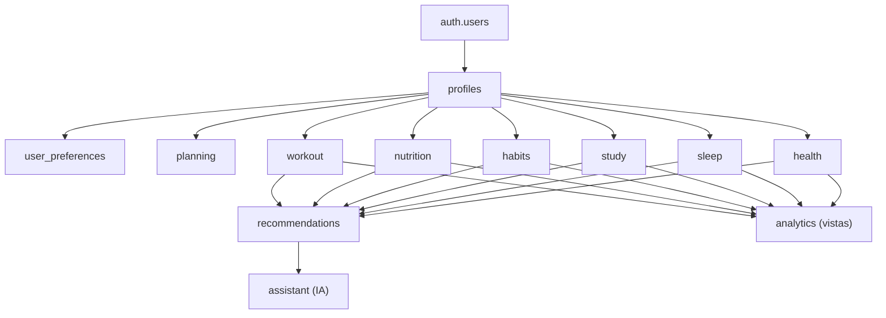
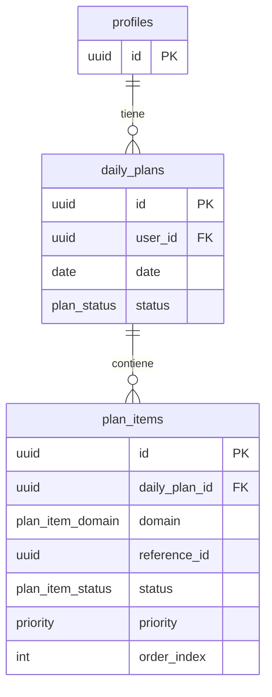
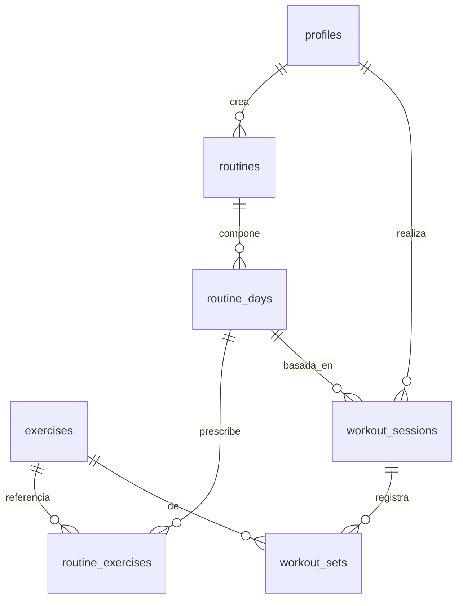
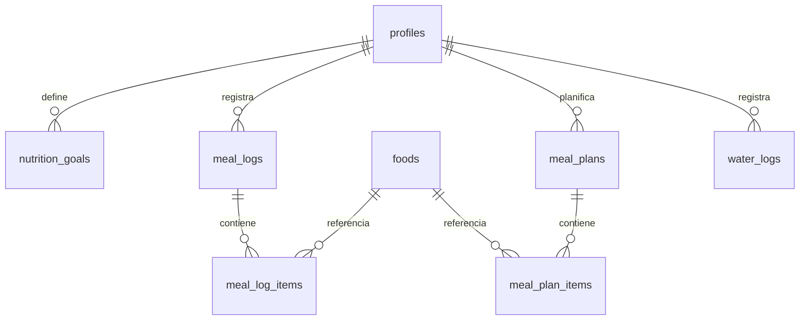
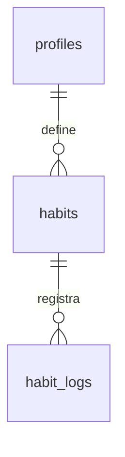
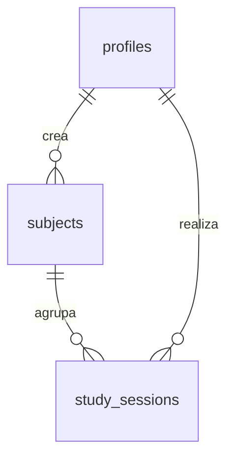
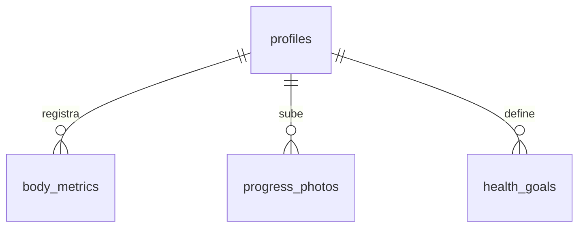

# 04 · Modelo de datos

Este documento describe las **entidades y sus relaciones** a nivel conceptual. El
esquema físico (columnas, tipos, índices, RLS, migraciones) está en
[05 · Base de datos](./05-base-de-datos.md). Ambos deben mantenerse coherentes.

## Convenciones del modelo

- Toda entidad tiene: `id` (UUID), `created_at`, `updated_at`.
- Toda entidad que pertenece a una persona tiene `user_id` → `auth.users(id)`.
- Las entidades que se registran offline llevan `deleted_at` (borrado lógico) para
  soportar _tombstones_ de sincronización (ver [13 · Offline y PWA](./13-offline-y-pwa.md)).
- Los **catálogos** (`exercises`, `foods`) admiten filas **globales**
  (`user_id NULL`, semilla del sistema) y filas **personalizadas** del usuario.
- Base **completamente normalizada**; se usa JSONB sólo donde la forma es
  intrínsecamente variable (p. ej. `data` de una recomendación).

## Tipos enumerados

| Enum                     | Valores                                                                                            |
| ------------------------ | -------------------------------------------------------------------------------------------------- |
| `unit_system`            | `metric`, `imperial`                                                                               |
| `theme_preference`       | `system`, `light`, `dark`                                                                          |
| `sex`                    | `male`, `female`, `other`, `unspecified`                                                           |
| `plan_status`            | `draft`, `active`, `completed`                                                                     |
| `plan_item_domain`       | `workout`, `nutrition`, `study`, `habit`, `sleep`, `health`                                        |
| `plan_item_status`       | `pending`, `in_progress`, `done`, `skipped`, `rescheduled`                                         |
| `priority`               | `low`, `medium`, `high`, `critical`                                                                |
| `workout_session_status` | `planned`, `in_progress`, `completed`, `skipped`                                                   |
| `muscle_group`           | `chest`, `back`, `shoulders`, `biceps`, `triceps`, `legs`, `glutes`, `core`, `full_body`, `cardio` |
| `equipment`              | `none`, `barbell`, `dumbbell`, `machine`, `cable`, `kettlebell`, `band`, `bodyweight`              |
| `meal_type`              | `breakfast`, `lunch`, `dinner`, `snack`                                                            |
| `habit_frequency`        | `daily`, `weekly`, `custom`                                                                        |
| `body_metric_type`       | `weight`, `body_fat`, `waist`, `hip`, `chest`, `arm`, `thigh`, `neck`                              |
| `recommendation_type`    | `day_recalculation`, `meal_swap`, `alternative_routine`, `alert`, `insight`                        |
| `recommendation_status`  | `pending`, `accepted`, `dismissed`, `expired`                                                      |
| `notification_channel`   | `in_app`, `push`                                                                                   |

## Mapa de dominios

## Núcleo (identidad y preferencias)

- **profiles**: extiende `auth.users` (misma `id`). Datos de perfil: nombre,
  avatar, zona horaria, `locale`, `unit_system`, `sex`, fecha de nacimiento,
  `height_cm`, estado de onboarding.
- **user_preferences**: ajustes de la app (tema, inicio de semana, horarios de
  recordatorio, activación de notificaciones). **Sólo preferencias de UX**, no
  objetivos de dominio.

## Planning (núcleo adaptativo)

Es el "pegamento" que hace de Nexus un sistema, no una suma de apps.

- **daily_plans**: el plan de un día (`date`, `status`, `generated_at`).
- **plan_items**: cada elemento del plan; referencia **polimórfica** a una entidad
  de dominio vía (`domain`, `reference_id`), con `scheduled_start/end`, `status`,
  `priority`, `order`. El [Decision Engine](./06-decision-engine-e-ia.md) crea,
  reprograma y re-prioriza estos ítems al recalcular el día.

## Workout

- **exercises**: catálogo (global o personal) con `muscle_group`, `equipment`,
  instrucciones. Base para calcular **rutinas alternativas** (mismo grupo, otro
  equipo).
- **routines**: plantilla de rutina (`name`, `goal`, `days_per_week`, `is_active`).
- **routine_days**: día lógico dentro de una rutina (p. ej. "Push").
- **routine_exercises**: ejercicio prescrito en un `routine_day` (series, reps,
  peso objetivo, descanso, orden).
- **workout_sessions**: entrenamiento realizado (`status`, inicio/fin, esfuerzo).
- **workout_sets**: serie realizada dentro de una sesión (reps, peso, RPE, warmup).

### Los ejercicios de una sesión se derivan de sus series

No existe una tabla intermedia entre `workout_sessions` y `exercises`: **un
ejercicio forma parte del entrenamiento porque tiene series registradas**. La
lista de ejercicios de una sesión se obtiene agrupando sus `workout_sets`.

Ventajas: no hay dos sitios donde consultar lo mismo (ni un estado
"ejercicio añadido pero vacío" que mantener sincronizado), y borrar la última
serie de un ejercicio lo quita de la sesión sin dejar filas huérfanas.

Consecuencia asumida: elegir un ejercicio y todavía no registrar ninguna serie
es un estado **sólo de la interfaz**; si se recarga la página, se pierde. Es el
comportamiento correcto: un ejercicio sin series no se hizo.

`set_number` conserva el orden de registro y **nunca se reutiliza** (si se borra
una serie, la siguiente sigue numerando hacia arriba). La numeración que ve el
usuario —"Serie 1", "Serie 2"— es posicional y se calcula al mostrar.

### Entrenar siguiendo una rutina

Una sesión puede nacer de un día de rutina: se guarda su `routine_day_id` y de
ahí se leen los **ejercicios prescritos**, que la pantalla precarga junto a sus
objetivos. El plan **no viaja en la navegación**: se lee del servidor en cada
carga, así sigue ahí aunque se recargue la página a mitad del entrenamiento.

La regla anterior se mantiene: un ejercicio prescrito **no forma parte** de la
sesión hasta que tiene series. Si no se hace, simplemente no aparece en el
historial; no hace falta "saltarlo" de forma explícita.

## Nutrition (económica)

- **foods**: catálogo (global o personal) con macros por porción **y
  `cost_per_serving`** (clave para la nutrición económica).
- **nutrition_goals**: objetivos activos del usuario (calorías, proteína, carbos,
  grasa, `water_ml_target` y **`weekly_food_budget`**). Historial vía
  `is_active` + `effective_from`.
- **meal_plans / meal_plan_items**: plan de comidas planificado.
- **meal_logs / meal_log_items**: comidas realmente registradas; los macros y el
  coste se derivan de los items (cantidad × alimento).
- **water_logs**: registros de hidratación (`amount_ml`, `logged_at`).

## Habits

- **habits**: definición del hábito (`name`, `frequency`, `target_count`,
  `target_weekdays`, color, icono, `is_active`, `archived_at`).
- **habit_logs**: cumplimiento por fecha (`date`, `count`, `completed`). Las
  **rachas** se calculan en el motor/servicio a partir de estos registros (no se
  almacenan de forma duplicada).

### Archivar guarda; sólo `archived_at` decide qué se ve

Un hábito archivado **sale de la lista del día pero no se pierde**: se consulta
y se recupera desde «Hábitos archivados», y vuelve con su racha y su constancia
intactas, porque su historial nunca se tocó. Archivar sin poder deshacerlo sería
un borrado con otro nombre.

Qué columna manda, para que no haya dudas:

| Columna        | Significado                                    | ¿La lee la app?                 |
| -------------- | ---------------------------------------------- | ------------------------------- |
| `archived_at`  | Retirado de la lista, con la fecha en que fue. | **Sí**: es la única que filtra. |
| `deleted_at`   | Borrado lógico, para sincronizar offline.      | Sí, en todas las consultas.     |
| `is_active`    | Heredada del esquema inicial.                  | **No.** Ver abajo.              |
| `target_count` | Cuántas veces al día hay que cumplirlo.        | **No**: hoy se asume 1.         |

`is_active` **duplicaría** lo que ya dice `archived_at`, y dos formas de expresar
«este hábito no está en juego» son una invitación a que se desincronicen: se deja
sin usar a propósito. `target_count` es distinto — no lo duplica nadie y, junto a
`habit_logs.count`, es lo que soportará «3 vasos al día» cuando esa funcionalidad
se aborde; mientras tanto un hábito se cumple o no se cumple.

### Cómo se cuenta una racha

La racha **no se almacena**: se calcula a partir de los `habit_logs`, para que
no pueda quedar desincronizada. Dos reglas la definen:

1. **Si hoy todavía no está marcado, la racha no se rompe.** El día no ha
   terminado, así que se cuenta hasta ayer. Ver una racha de 30 días a cero a
   las nueve de la mañana desmotiva y además es falso: aún no se ha fallado.
2. **Se rompe en cuanto falta un día anterior.** Ahí el hábito sí se dejó.

Sólo cuentan los registros con `completed = true`; uno en `false` es «lo
intenté y no salió», que no suma.

**Una racha no tiene techo.** El servicio trae primero los últimos 60 días —lo
que necesitan el mini-calendario y la constancia— y **sólo si alguna racha sigue
viva en el día más antiguo traído** pide otro tramo hacia atrás (un año por
viaje). Así una racha de 200 días se cuenta entera y la carga habitual se
resuelve con una única consulta: quien no encadena años no paga por los que sí.
Recortarla al borde de la ventana castigaría justo a quien mejor lo hace.

### Se pueden corregir días pasados

Olvidarse de marcar ayer es lo más común que le pasa a un hábito, así que cada
día del mini-calendario es un interruptor: la fecha y el estado ya están en
pantalla. Los días **anteriores a la creación del hábito** se muestran apagados
y no se pueden tocar — ahí no existía, y marcarlos sumaría a la racha días que
la constancia no cuenta.

Por eso el servicio recibe el día como clave `YYYY-MM-DD` (lo que guarda la
columna `date`) en lugar de un instante: un hábito se cumple «el martes», y así
corregir un día pasado no obliga a convertir fechas de ida y vuelta.

### Desmarcar borra el registro

Quitar la marca de un día hace un **borrado real**, no lógico, a diferencia del
resto del modelo. El motivo es el índice único `uq_habit_logs_habit_date` sobre
(`habit_id`, `date`) _donde `deleted_at is null`_: dejar una fila marcada como
borrada ocuparía el hueco e impediría volver a marcar ese mismo día. Además,
para una racha «no lo hice» y «no lo registré» son lo mismo.

### La constancia se mide desde que el hábito existe

Junto a la racha se muestra la **constancia**: cuántos de los últimos 30 días se
cumplió. La ventana **nunca empieza antes de la creación del hábito**: uno
creado anteayer y cumplido los dos días vale «2 de 2 · 100 %», no
«2 de 30 · 7 %». Penalizar días en los que el hábito no existía sería falso y
desmotivaría justo al empezar.

Sale de los registros que ya se consultan para la racha, así que no cuesta
ninguna consulta extra. Es deliberadamente **una línea y no un calendario
mensual**: responde «¿lo estoy manteniendo?», que es lo que se consulta a
diario. Las vistas históricas ricas (gráficas, comparativas) pertenecen a
[Analytics](./09-roadmap-y-sprints.md), no a cada dominio.

### La fecha es local

`habit_logs.date` es una columna `date`, no `timestamptz`: un hábito se cumple
«el martes», no «a las 21:04 del martes». Se guarda la fecha **local** del
usuario para que marcar a las 23:50 cuente en el día que está viviendo.

## Study

- **subjects**: materia (`name`, color, `weekly_target_minutes`).
- **study_sessions**: sesión de estudio (`subject_id`, inicio/fin,
  `duration_minutes`, `focus_rating`, técnica). Soporta las **horas variables**:
  el motor compara horas reales vs objetivo semanal y ajusta el plan.

### La duración se almacena; los totales se calculan

`duration_minutes` es la **excepción** a la regla de calcular en vez de
almacenar, y es deliberada: una sesión se registra _después_ de estudiar («hoy
le metí hora y media»), cuando ya no hay un inicio y un fin fiables que restar.
La duración es el dato que el usuario aporta; `started_at` y `ended_at` sólo
sitúan la sesión en el día. Al registrar N minutos se coloca hacia atrás desde
ahora, así queda a una hora verosímil.

Los **totales** (del día, por materia) sí se calculan siempre a partir de las
sesiones, como el resto del proyecto.

### El objetivo se guarda en minutos y se pide en horas

`weekly_target_minutes` está en minutos porque es la unidad en que se mide todo
lo demás del dominio, pero nadie piensa su semana en minutos: el formulario pide
horas («7,5») y el servicio traduce. La conversión vive en el servicio, no en el
componente.

### Una sesión sin materia cuenta, pero no se puede crear

`subject_id` admite nulo en el esquema y la aplicación **siempre exige materia**:
sin ella, «¿en qué estudié?» se queda sin respuesta y el objetivo semanal no
tiene a qué agarrarse. El código tolera el nulo (esas sesiones suman al total del
día sin aparecer en el reparto por materia) para no romperse ante datos
importados o anteriores.

## Sleep

- **sleep_logs**: registro por noche (`date`, `bedtime`, `wake_time`,
  `duration_minutes`, `quality_rating`, interrupciones).
- **sleep_goals**: objetivo de sueño (`target_minutes`, `target_bedtime`,
  `target_wake_time`).

## Health

- **body_metrics**: medición corporal normalizada
  (`metric_type`, `value`, `unit`, `measured_at`). El **IMC** se calcula (peso +
  `height_cm` del perfil), no se almacena.
- **progress_photos**: foto de progreso (`storage_path`, `angle`, `taken_at`,
  `weight_kg` snapshot). El binario va a Storage, no a la BD.
- **health_goals**: objetivos (`target_weight_kg`, `target_body_fat_pct`…).

## Inteligencia y comunicación

- **recommendations**: salida del Decision Engine (`type`, `domain`, `title`,
  `message`, `reason`, `data` JSONB, `priority`, `status`, `valid_until`). El
  usuario las acepta o descarta.
- **assistant_conversations / assistant_messages**: historial de la capa de IA
  (chat). La IA lee recomendaciones y datos; nunca ejecuta lógica crítica.
- **notifications**: notificaciones (`type`, `title`, `body`, `scheduled_for`,
  `sent_at`, `read_at`, `channel`).

## Analytics

Analytics **no** introduce tablas nuevas de datos primarios: se implementa con
**vistas** y, cuando el rendimiento lo exija, una tabla de _rollup_
**daily_summaries** (agregados por día y dominio) que se recalcula de forma
idempotente. Se decide en su sprint con evidencia (evitar optimización prematura).

## Integridad y borrado

- **FK con `on delete cascade`** desde los hijos hacia su agregado raíz
  (p. ej. `workout_sets` → `workout_sessions`).
- **Borrado de usuario**: `on delete cascade` desde `auth.users` para cumplir
  privacidad (derecho al olvido).
- **Catálogos globales** referenciados por logs usan `on delete restrict` (no se
  borra un alimento global si hay registros que lo usan); los personalizados, la
  estrategia se documenta en [05](./05-base-de-datos.md).
