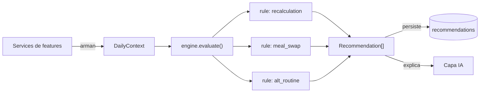
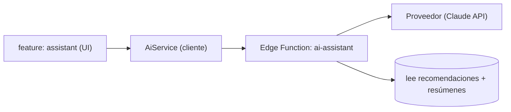

# 06 · Decision Engine e IA

Nexus se diferencia por **ayudar a decidir**, no sólo a registrar. Esa capacidad
vive en dos capas separadas y con responsabilidades que **nunca** se mezclan:

1. **Decision Engine** — reglas deterministas. Es la lógica crítica.
2. **Capa de IA** — interpretación y explicación. Es opcional.

Regla constitucional: _el sistema debe seguir funcionando aunque la IA
desaparezca_ ([ADR-0003](./adr/0003-ia-como-capa-de-interpretacion.md)).

---

## Parte A · Decision Engine

### Qué es y qué no es

| Es                                                         | No es                                       |
| ---------------------------------------------------------- | ------------------------------------------- |
| Un módulo **puro** de TypeScript (`src/decision-engine/`). | Una feature con UI.                         |
| Determinista: mismas entradas → mismas salidas.            | Un modelo de IA / red neuronal.             |
| Independiente de React, Supabase y de las features.        | Un lugar para consultar la BD.              |
| 100% testeable en aislamiento.                             | Un ejecutor de acciones (sólo **sugiere**). |

### Contratos (entrada / salida)

El motor no conoce las features: define **contratos** que las features rellenan.

**Entrada — `DailyContext`** (snapshot normalizado del usuario y su día):

```ts
interface DailyContext {
  date: string // ISO (día evaluado)
  now: string // ISO (momento de evaluación)
  goals: {
    nutrition?: NutritionGoal // macros y agua; el dinero es de finanzas
    sleepMinutes?: number
    studyWeeklyMinutes?: number
  }
  plan: PlanItemSnapshot[] // ítems del día y su estado
  workout: {
    recentSessions: SessionSnapshot[]
    activeSessionStartedAt?: string
    routineDays: RoutineDaySnapshot[] // para proponer una versión más corta
  }
  nutrition: {
    todayIntake: MacroTotals
    todayWaterMl: number
    todayFoods: LoggedFoodSnapshot[] // lo comido hoy, alimento a alimento
    pantry: FoodSnapshot[] // el catálogo, para poder proponer alternativas
  }
  study: { weekMinutes: number }
  habits: { total: number; done: number }
  sleep: { lastNightMinutes?: number }
}
```

### El contrato sólo declara lo que alguna regla lee

Llegó a pedir más: el **perfil** (sexo, altura, fecha de nacimiento), los
**límites del día** (`constraints`: tiempo, equipo, energía), el **peso
objetivo** y la **calidad del sueño**. Ninguna regla leía nada de eso.

Peor: los dos primeros ni siquiera se rellenaban con datos reales. `constraints`
se mandaba siempre `{}` y el sexo iba fijo como `'unspecified'` — un valor que el
usuario nunca había dicho, inventado sólo para que el objeto compilara.

**Un contrato que pide lo que no usa miente dos veces:** hace creer que el motor
sabe cosas que no sabe, y obliga a quien lo rellena a inventarse valores. Cuando
una regla nueva necesite el peso o la energía disponible, el campo entra **con
ella** — que es cuando se sabe qué forma tiene que tener y de dónde sale.

`todaySpend` se fue por otro motivo, en el mismo espíritu: el dinero lo cuenta
finanzas (ver [04](./04-modelo-de-datos.md)).

**Salida — `Recommendation`**:

```ts
interface Recommendation {
  key: string // identidad estable entre evaluaciones, para poder descartarla
  type: RecommendationType // day_recalculation | meal_swap | alternative_routine | alert | insight
  domain?: PlanItemDomain
  priority: Priority // low | medium | high | critical
  title: string // corto, humano
  message: string // qué se sugiere
  reason: string // POR QUÉ (transparencia obligatoria)
  data: Record<string, unknown> // payload accionable (ítems reprogramados, swaps…)
  validUntil?: string // ISO
}
```

Toda recomendación **explica su motivo** y expone los **datos que usó**: es un
requisito de producto, no un adorno.

### Modelo de reglas

Cada regla es una **función pura** con una única responsabilidad, en su propio
archivo bajo `rules/`:

```ts
interface Rule {
  id: string // p. ej. "day-recalculation@1"
  appliesTo(ctx: DailyContext): boolean
  evaluate(ctx: DailyContext): Recommendation[]
}
```

El orquestador (`engine.ts`) recibe el `DailyContext`, ejecuta las reglas
aplicables, ordena las recomendaciones por `priority` y las devuelve. Sin efectos
secundarios: **no persiste nada**; persistir es tarea del service que lo invoca.



### Primeras reglas activas (Plan del día)

Adelantadas al Sprint 9 —antes que las insignia— porque **una app que sólo
registra no ayuda a decidir**, y estas cuatro se construyen con lo que las
features ya guardan, sin datos nuevos. Alimentan la pantalla `/plan`, que
responde «¿qué me falta hoy?».

| Regla                    | Cuándo habla                                     | Prioridad                         |
| ------------------------ | ------------------------------------------------ | --------------------------------- |
| `water-pending@1`        | Hay objetivo de agua y aún falta.                | Sube a alta a partir de las 19 h. |
| `habits-pending@1`       | Quedan hábitos sin marcar.                       | Sube a alta a partir de las 20 h. |
| `workout-gap@1`          | 3+ días desde el último entrenamiento.           | Alta a partir de una semana.      |
| `workout-open-session@1` | Un entrenamiento lleva 6+ horas sin cerrar.      | Media.                            |
| `study-behind@1`         | El estudio va por debajo del ritmo de la semana. | Alta el último día.               |
| `sleep-short@1`          | Se durmió menos de 6 h.                          | Alta por debajo de 5 h.           |

`sleep-short` es la primera regla que **cruza dos dominios**: mira el sueño para
hablar del entrenamiento («si hoy entrenas, plantéate bajar el volumen»). Ahí
empieza a haber criterio y no sólo recordatorios. Sugiere sin afirmar: da el dato
y propone, sin prometer resultados ni dar consejo médico.

`workout-open-session` salió de **usar la app**: había una sesión vacía con el
cronómetro en 108 horas mientras el plan decía «llevas 7 días sin entrenar». Las
dos cosas eran ciertas —una sesión sin terminar no cuenta como entrenamiento—
pero juntas el sistema se contradecía. La regla saca el enganche a la luz en vez
de cerrarlo por su cuenta: el motor **sugiere**, no ejecuta.

### Reglas insignia (Sprint 13)

Las anteriores **recuerdan lo pendiente**. Éstas **proponen una decisión mejor**,
que es lo que separa a Nexus de un cuaderno de registros.

| Regla                   | Cuándo habla                                                       | Prioridad                          |
| ----------------------- | ------------------------------------------------------------------ | ---------------------------------- |
| `meal-swap@1`           | Algo de lo comido hoy tiene alternativa más barata igual de buena. | Alta si el ahorro pasa de $10.000. |
| `alternative-routine@1` | Pasadas las 19 h sin entrenar, habiendo rutina que acortar.        | Media.                             |
| `day-recalculation@1`   | Lo que queda del plan ya no cabe en lo que queda de día.           | Alta.                              |

**`meal-swap@1`** es la regla de la **nutrición económica**, el diferencial del
producto. Cuatro decisiones la hacen honesta:

- **Mira hacia adelante.** El alimento ya se comió y eso no tiene vuelta; la
  sugerencia es «la próxima vez», y el «repetir comida» de la app la vuelve
  accionable de un toque.
- **No abarata a costa de comer peor.** Sólo propone alternativas que aportan al
  menos las mismas calorías **y** la misma proteína. Recortar no es aconsejar.
- **Nada de raciones absurdas.** Tope de 4 porciones: seis de arroz igualan una
  hamburguesa en la hoja de cálculo y son incomibles.
- **Una sola sugerencia, la de mayor ahorro.** Un plan que abre con seis
  propuestas de comida no se lee. Y calla por debajo de $2.000: nadie cambia lo
  que come por calderilla, y avisar por eso entrena a ignorar los avisos.

Para poder compararlos, el `DailyContext` incorpora en `nutrition` los alimentos
**registrados hoy** (`todayFoods`, con su coste) y el **catálogo del usuario**
(`pantry`). Sin despensa no hay swap posible: decir «come otra cosa» sin decir
cuál no ayuda a decidir nada.

**`alternative-routine@1`** rebaja el listón a algo que todavía cabe, que es
justo el momento en que la gente lo deja. La dispara **el reloj y no el sueño**:
`sleep-short@1` ya habla de bajar volumen cuando se ha dormido mal, y dos reglas
contando lo mismo con distintas palabras son ruido. Ésta responde a otra
pregunta —«se me acaba el día»— y por eso puede convivir con aquélla.

Elige el día de rutina que lleva **más tiempo sin tocarse** (el que toca por
rotación) y se queda con la cabeza de su lista, porque por convención los
primeros ejercicios de un día son los básicos. Sólo acorta días de **cuatro
ejercicios o más**: recortar uno de tres no es una alternativa, es quitar uno.

Para eso el `DailyContext` gana `workout.routineDays` —lo que se planea
entrenar— y `routineDayId` en cada sesión, de donde sale la rotación.

Dos detalles de redacción que salieron de verla con datos reales: el día se
nombra **sin adjetivarlo** (el nombre lo pone el usuario y «Pierna entero» no
concuerda), y la hora se da como «pasadas las 20:00», porque a las 20:30 decir
«son las 20:00» es falso y una cifra inventada resta credibilidad a todo lo demás.

### Descartar una recomendación

Decidir incluye decir que no. Cada tarjeta del plan se puede **descartar hasta
mañana**: una sugerencia que reaparece después de rechazarla deja de ser un
consejo y pasa a ser una insistencia.

Cómo se sostiene sin ensuciar el motor:

- Cada `Recommendation` lleva una **clave estable** (`key`). El motor se ejecuta
  en cada visita, así que la misma sugerencia nace una y otra vez; sin una clave
  que la reconozca no hay forma de recordar que ya se rechazó. Lleva la versión
  de la regla y, cuando ésta puede hablar de cosas distintas, de qué habla:
  `meal-swap@1:<idDelAlimento>`. **Cambiar la versión invalida los descartes**,
  que es lo correcto: si el criterio cambió, merece otra oportunidad.
- El motor **no sabe nada de esto**. Sigue siendo puro: evalúa entero y es el
  hook de `planning` quien filtra lo descartado después.
- **No se persisten las recomendaciones**, sólo los descartes. Las primeras se
  recalculan de lo registrado —que es lo que las mantiene ciertas—; un descarte
  es una decisión del usuario y no se puede deducir de ningún dato.
- Caduca a **medianoche** (`valid_until`), no para siempre. El descarte dice «hoy
  no»; mañana el contexto es otro. Silenciar algo indefinidamente habría que
  preguntarlo, y no se ha preguntado.

### El plan que se pone el usuario, y `day-recalculation@1`

La pantalla `/plan` tiene **dos capas que no se mezclan**: arriba lo que el
usuario se propuso (`daily_plans` + `plan_items`, su agenda), abajo lo que el
motor sugiere a la vista de lo registrado. Juntarlas haría que las sugerencias
parecieran obligaciones, y Nexus recomienda: quien decide es él.

`day-recalculation@1` es la única regla que mira **el plan**, no lo registrado.
Suma lo que queda por hacer, lo compara con las horas que quedan de día y, si no
cabe, lo dice. Que lo diga en vez de callar es el punto: un plan que se acumula
sin avisar termina abandonado entero; uno que reconoce a tiempo que sobra una
cosa se puede salvar. **No reprograma nada**: propone mover, y mover lo decide el
usuario.

Cuatro decisiones que la hacen fiable:

- **El día útil acaba a las 23:00**, no a medianoche. Prometer la última hora
  haría que el aviso llegara siempre tarde.
- **Media hora de margen** antes de dar algo por atrasado. Empezar diez minutos
  tarde no es un plan roto, es la vida.
- **La hora es opcional al planificar.** Hay cosas que uno se propone «hoy» sin
  decidir cuándo; obligar a inventarse una hora produce horas falsas que la
  regla se tomaría en serio. A lo que no la tiene se le calculan 30 min.
- **Marcar algo como hecho recalcula solo.** Si con ello el resto ya cabe, el
  aviso desaparece sin que nadie lo cierre.

Queda fuera de esta versión enlazar un ítem con la entidad que representa
(`reference_id`: este día de rutina, esta materia). Con él, el plan podría darse
por cumplido al registrar la actividad en vez de a mano.

Tres decisiones que las hacen útiles en vez de ruidosas:

- **Comparan con lo que toca ahora, no con el objetivo entero.** `study-behind`
  mide contra la parte del objetivo que corresponde al día de la semana en que
  se está; si no, avisaría todos los lunes.
- **Callan cuando no hay nada que decir.** `workout-gap` no habla si nunca se ha
  entrenado: recordarle a alguien que no ha empezado no ayuda. `study-behind` no
  habla el lunes: con un día vivido no hay evidencia de retraso.
- **No recriminan.** Los mensajes hablan de lo que queda por hacer, nunca de lo
  fallado (ver [11 · UX](./11-ux-ui-y-diseno.md#gamificación)).

### Reglas insignia (v1)

#### 1. Recálculo del día (`day_recalculation`)

**Disparador:** un `plan_item` pasa a `skipped`, o cambian las `constraints`
(menos tiempo/energía disponibles).
**Lógica:** re-priorizar y reprogramar los ítems `pending` restantes según
prioridad del dominio, tiempo/energía disponibles y objetivos de la semana. Un
ítem no realizado de alta prioridad puede reprogramarse a otra franja o a otro
día; los de baja prioridad pueden posponerse.
**Salida:** recomendación con el nuevo orden/horarios propuesto en `data` (el
usuario confirma antes de aplicarlo).

#### 2. Cambio de comida dentro del presupuesto (`meal_swap`)

**Disparador:** desvío de macros del día, o petición explícita. **No mira ningún
presupuesto**: compara precios por porción, que es un atributo del alimento. El
dinero lo cuenta finanzas (ver [04](./04-modelo-de-datos.md)).
**Lógica:** buscar en el catálogo de `foods` (globales + propios, priorizando
`pantry` si existe) combinaciones que **cierren el hueco de macros** minimizando
`cost_per_serving`. Es un problema de optimización acotado (greedy/mochila
sencilla), determinista.
**Salida:** sustituciones concretas (quitar X, añadir Y), con impacto en macros y
en coste.

#### 3. Rutina alternativa (`alternative_routine`)

**Disparador:** `availableMinutes` insuficiente para la sesión prescrita, falta de
`availableEquipment`, o `fatigueSignals` altos.
**Lógica:** por cada ejercicio prescrito, elegir un **equivalente** del catálogo
(mismo `muscle_group`, `equipment` disponible) y/o reducir volumen (series) para
encajar en el tiempo/energía disponibles, preservando los grupos musculares clave.
**Salida:** sesión alternativa propuesta (lista de ejercicios/series).

### Determinismo, versionado y pruebas

- **Determinismo:** el motor no lee reloj ni aleatoriedad por su cuenta; recibe
  `now` en el contexto. Esto lo hace reproducible y testeable.
- **Versionado:** cada regla lleva versión en su `id` (`meal-swap@1`). Cambiar el
  comportamiento crea una versión nueva; se documenta el cambio.
- **Pruebas:** el motor es prioridad de testing (constitución). Se prueba con
  `DailyContext` fijos → recomendaciones esperadas, sin mocks de red ni de BD.

### Cómo lo consumen las features

1. Cada feature expone desde su **barrel** un hook que construye su parte del
   `DailyContext` (`useNutritionContext`, `useHabitsContext`, `useStudyContext`,
   `useWorkoutContext`). Devuelven **datos**, no frases: son los hermanos de los
   hooks de resumen, que sí devuelven texto porque los consume una pantalla.
2. `useDailyPlan` (en `planning`) los reúne y llama a `evaluate(context)`.
3. La UI muestra las `Recommendation[]` en `/plan`, cada una **con su motivo**.

Dos detalles que importan:

- **No se evalúa con datos a medias.** Mientras algún dominio carga, el plan
  espera: con ceros saldrían avisos falsos («te falta toda el agua») que
  desaparecerían un segundo después.
- **Todavía no se persisten.** Las recomendaciones se calculan al vuelo cada vez.
  Guardarlas en la tabla `recommendations` sólo hace falta cuando haya que
  recordar si el usuario las aceptó o descartó, que llega con el Sprint 13.

---

### Comparar contigo, no contra una constante

Las reglas empezaron midiendo contra umbrales de fábrica: «menos de seis horas es
dormir poco». Eso trata igual a quien duerme ocho y a quien se apaña con cinco y
media — al primero no le decía nada nunca, y al segundo le avisaba cada mañana.

Desde el 2026-08-29 el contexto lleva **lo normal en el usuario** para las medidas
que lo admiten (`TypicalValue`), y las reglas escogen su vara en este orden:

1. **Su objetivo**, si lo fijó. Es lo que él decidió y manda sobre lo demás.
2. **Su costumbre**, la mediana de sus últimos treinta días.
3. **La referencia general**, sólo cuando no se sabe nada de él.

Tres decisiones que sostienen esto:

- **Mediana y no media.** Una noche de tres horas arrastra una media de siete a
  seis y media, y a partir de ahí la aplicación diría durante semanas que duermes
  menos de lo que duermes. Sobre datos reales la diferencia entre una y otra fue
  de 16 minutos.
- **Un mínimo de días, y si no se calla.** Menos de siete días no es una
  costumbre, es una temporada. Es mejor no decir nada que decir «lo normal en ti»
  apoyándose en tres noches.
- **El motor recibe el número, no lo calcula.** La estadística vive en
  `shared/utils/baseline`; el motor sigue sin depender de nada de fuera.

El mensaje **dice contra qué se comparó**: «40 min menos de tu objetivo» y
«sueles dormir 7 h 23 min, contando tus últimos 15 días» son dos afirmaciones
distintas, y quien lee tiene derecho a saber cuál le están dando.

#### El peso lo usa, y no pasa por el motor

La misma `baselineOf` compara la pesada de hoy contra lo normal en Salud, pero
**ahí no hay regla ninguna**: la pantalla llama a la utilidad y ya. La diferencia
no es de comodidad, es de qué hace cada cosa. Una regla del motor produce un
consejo —«haz esto»—, y del peso no sale ningún consejo: sale un dato. Si 89,7
está bien o mal depende de qué persigue quien se pesa, y eso Nexus no lo sabe
(Salud no opina, docs/11).

Dos cosas que salieron de medirlo sobre 62 pesadas reales:

- **Dos ventanas y no una.** Cuánto pesas cambia con las semanas, pero cuánto
  oscila la báscula —el agua, la comida, la hora— es una propiedad tuya que no
  cambia. Lo normal sale de 30 días; el vaivén, de 90. Con los 30 días para
  ambos el vaivén daba 0,20 kg y la aplicación habría llamado rara casi cualquier
  pesada.
- **Se calla cuando no hay nada que mirar.** La línea aparece sólo si la pesada
  se sale del vaivén de siempre. Decir «estás en lo tuyo» cada mañana convierte
  el dato en ruido.

## Parte B · Capa de IA

### Rol y límites

La IA se sitúa **por encima** del motor. Su función:

- **Interpretar** y **explicar** recomendaciones en lenguaje natural.
- **Resumir** el día/semana/mes.
- **Responder** preguntas del usuario sobre sus datos.

Prohibido para la IA:

- Ejecutar lógica crítica o **reemplazar** al Decision Engine.
- Modificar registros automáticamente.
- Inventar datos o exagerar resultados. Cuando recomienda, **muestra los datos**
  que usó y evita afirmaciones absolutas.

### Arquitectura de la IA



- La feature `assistant` llama a `AiService`.
- `AiService` invoca la **Edge Function** `ai-assistant`, que **guarda la API
  key** del proveedor (por defecto la **API de Claude** con los modelos más
  recientes) y arma el prompt con el contexto ya calculado por el motor.
- La clave **nunca** vive en el cliente ([12 · Seguridad](./12-seguridad.md)).
- El historial se guarda en `assistant_conversations` / `assistant_messages`.

### Degradación elegante

Si la IA está desactivada o falla, Nexus sigue **100% funcional**: el motor
produce recomendaciones con su `reason` legible; la IA sólo añade una capa de
explicación más rica. La app nunca bloquea una acción por depender de la IA.
