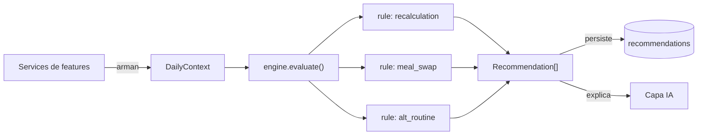
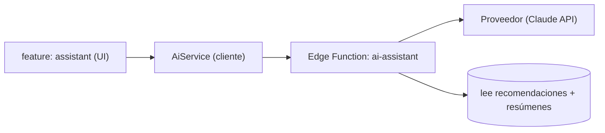

# 06 · Decision Engine e IA

Nexus se diferencia por **ayudar a decidir**, no sólo a registrar. Esa capacidad
vive en dos capas separadas y con responsabilidades que **nunca** se mezclan:

1. **Decision Engine** — reglas deterministas. Es la lógica crítica.
2. **Capa de IA** — interpretación y explicación. Es opcional.

Regla constitucional: _el sistema debe seguir funcionando aunque la IA
desaparezca_ ([ADR-0003](./adr/0003-ia-como-capa-de-interpretacion.md)).

---

## Parte A · Decision Engine

### Qué es y qué no es

| Es                                                         | No es                                       |
| ---------------------------------------------------------- | ------------------------------------------- |
| Un módulo **puro** de TypeScript (`src/decision-engine/`). | Una feature con UI.                         |
| Determinista: mismas entradas → mismas salidas.            | Un modelo de IA / red neuronal.             |
| Independiente de React, Supabase y de las features.        | Un lugar para consultar la BD.              |
| 100% testeable en aislamiento.                             | Un ejecutor de acciones (sólo **sugiere**). |

### Contratos (entrada / salida)

El motor no conoce las features: define **contratos** que las features rellenan.

**Entrada — `DailyContext`** (snapshot normalizado del usuario y su día):

```ts
interface DailyContext {
  date: string // ISO (día evaluado)
  now: string // ISO (momento de evaluación)
  profile: { sex: Sex; birthDate?: string; heightCm?: number }
  goals: {
    nutrition?: NutritionGoal // macros + weeklyFoodBudget
    sleepMinutes?: number
    studyWeeklyMinutes?: number
    weightKg?: number
  }
  plan: PlanItemSnapshot[] // ítems del día y su estado
  workout: { recentSessions: SessionSnapshot[]; fatigueSignals: FatigueSignal[] }
  nutrition: { todayIntake: MacroTotals; todaySpend: number; pantry?: FoodRef[] }
  study: { weekMinutes: number }
  sleep: { lastNightMinutes?: number; quality?: number }
  constraints: {
    // límites del día real
    availableMinutes?: number
    availableEquipment?: Equipment[]
    energyLevel?: 'low' | 'normal' | 'high'
  }
}
```

**Salida — `Recommendation`**:

```ts
interface Recommendation {
  type: RecommendationType // day_recalculation | meal_swap | alternative_routine | alert | insight
  domain?: PlanItemDomain
  priority: Priority // low | medium | high | critical
  title: string // corto, humano
  message: string // qué se sugiere
  reason: string // POR QUÉ (transparencia obligatoria)
  data: Record<string, unknown> // payload accionable (ítems reprogramados, swaps…)
  validUntil?: string // ISO
}
```

Toda recomendación **explica su motivo** y expone los **datos que usó**: es un
requisito de producto, no un adorno.

### Modelo de reglas

Cada regla es una **función pura** con una única responsabilidad, en su propio
archivo bajo `rules/`:

```ts
interface Rule {
  id: string // p. ej. "day-recalculation@1"
  appliesTo(ctx: DailyContext): boolean
  evaluate(ctx: DailyContext): Recommendation[]
}
```

El orquestador (`engine.ts`) recibe el `DailyContext`, ejecuta las reglas
aplicables, ordena las recomendaciones por `priority` y las devuelve. Sin efectos
secundarios: **no persiste nada**; persistir es tarea del service que lo invoca.



### Reglas insignia (v1)

#### 1. Recálculo del día (`day_recalculation`)

**Disparador:** un `plan_item` pasa a `skipped`, o cambian las `constraints`
(menos tiempo/energía disponibles).
**Lógica:** re-priorizar y reprogramar los ítems `pending` restantes según
prioridad del dominio, tiempo/energía disponibles y objetivos de la semana. Un
ítem no realizado de alta prioridad puede reprogramarse a otra franja o a otro
día; los de baja prioridad pueden posponerse.
**Salida:** recomendación con el nuevo orden/horarios propuesto en `data` (el
usuario confirma antes de aplicarlo).

#### 2. Cambio de comida dentro del presupuesto (`meal_swap`)

**Disparador:** desvío de macros del día, o exceso respecto al
`weekly_food_budget`, o petición explícita.
**Lógica:** buscar en el catálogo de `foods` (globales + propios, priorizando
`pantry` si existe) combinaciones que **cierren el hueco de macros** minimizando
`cost_per_serving`. Es un problema de optimización acotado (greedy/mochila
sencilla), determinista.
**Salida:** sustituciones concretas (quitar X, añadir Y), con impacto en macros y
en coste.

#### 3. Rutina alternativa (`alternative_routine`)

**Disparador:** `availableMinutes` insuficiente para la sesión prescrita, falta de
`availableEquipment`, o `fatigueSignals` altos.
**Lógica:** por cada ejercicio prescrito, elegir un **equivalente** del catálogo
(mismo `muscle_group`, `equipment` disponible) y/o reducir volumen (series) para
encajar en el tiempo/energía disponibles, preservando los grupos musculares clave.
**Salida:** sesión alternativa propuesta (lista de ejercicios/series).

### Determinismo, versionado y pruebas

- **Determinismo:** el motor no lee reloj ni aleatoriedad por su cuenta; recibe
  `now` en el contexto. Esto lo hace reproducible y testeable.
- **Versionado:** cada regla lleva versión en su `id` (`meal-swap@1`). Cambiar el
  comportamiento crea una versión nueva; se documenta el cambio.
- **Pruebas:** el motor es prioridad de testing (constitución). Se prueba con
  `DailyContext` fijos → recomendaciones esperadas, sin mocks de red ni de BD.

### Cómo lo consumen las features

1. Cada service expone un método para construir su parte del `DailyContext`.
2. Un `PlanningService` compone el `DailyContext` completo.
3. Llama a `engine.evaluate(ctx)`.
4. Persiste las `Recommendation[]` en la tabla `recommendations`.
5. La UI las muestra en el Dashboard/Planning; el usuario **acepta o descarta**.

---

## Parte B · Capa de IA

### Rol y límites

La IA se sitúa **por encima** del motor. Su función:

- **Interpretar** y **explicar** recomendaciones en lenguaje natural.
- **Resumir** el día/semana/mes.
- **Responder** preguntas del usuario sobre sus datos.

Prohibido para la IA:

- Ejecutar lógica crítica o **reemplazar** al Decision Engine.
- Modificar registros automáticamente.
- Inventar datos o exagerar resultados. Cuando recomienda, **muestra los datos**
  que usó y evita afirmaciones absolutas.

### Arquitectura de la IA



- La feature `assistant` llama a `AiService`.
- `AiService` invoca la **Edge Function** `ai-assistant`, que **guarda la API
  key** del proveedor (por defecto la **API de Claude** con los modelos más
  recientes) y arma el prompt con el contexto ya calculado por el motor.
- La clave **nunca** vive en el cliente ([12 · Seguridad](./12-seguridad.md)).
- El historial se guarda en `assistant_conversations` / `assistant_messages`.

### Degradación elegante

Si la IA está desactivada o falla, Nexus sigue **100% funcional**: el motor
produce recomendaciones con su `reason` legible; la IA sólo añade una capa de
explicación más rica. La app nunca bloquea una acción por depender de la IA.
