# 09 · Roadmap y Sprints

El proyecto se construye **por sprints**, uno a uno, **sin solapar módulos**. Cada
sprint termina **completamente** (según la Definición de "Hecho") antes de empezar
el siguiente. Este roadmap materializa las Fases 0–17 de la
[constitución](../CLAUDE.md).

## Flujo obligatorio de cada sprint

```
1. Analizar requerimientos
2. Diseñar la arquitectura del incremento
3. Actualizar la documentación (antes del código)
4. Crear la estructura de carpetas
5. Implementar backend (migraciones/RLS si aplica)
6. Implementar lógica (repository → service → hook)
7. Implementar UI
8. Pruebas
9. Refactor si hace falta
10. Commit / PR
11. Continuar
```

Nunca se salta un paso. Nunca se genera código masivo de golpe: se trabaja de
forma **incremental** y cada pieza compila y funciona antes de la siguiente.

## Definición de "Hecho"

Una funcionalidad **sólo** está terminada si cumple **todo** esto:

- [ ] Compila correctamente.
- [ ] Sin errores de TypeScript.
- [ ] Sin errores de ESLint.
- [ ] Respeta la arquitectura y las fronteras entre capas/features.
- [ ] Tipado completo (sin `any`/`ts-ignore`).
- [ ] Manejo de errores + estados: loading, success, empty, error, offline.
- [ ] Validaciones (Zod) donde entran datos.
- [ ] Responsive (móvil → desktop) y **mobile-first**.
- [ ] Dark mode correcto (design tokens, sin colores absolutos).
- [ ] Accesibilidad: teclado, foco visible, labels/ARIA, contraste.
- [ ] Sin duplicación ni deuda técnica evidente.
- [ ] Documentación afectada actualizada.
- [ ] Tests donde aportan valor (motor, services, flujos críticos).

## Roadmap por sprints

> Estimaciones **relativas** (talla), no fechas. La calidad manda sobre la
> velocidad.

### Sprint 0 — Fase 0 · Diseño y documentación · _(este entregable)_

- **Objetivo:** análisis, arquitectura, BD, estructura, plan de sprints y toda la
  documentación en `docs/`.
- **Entregable:** esta documentación, revisada y coherente.
- **Salida:** **detener y esperar aprobación del usuario.**

### Sprint 1 — Fase 1 · Inicialización y tooling · **S**

- Vite + React + TS (`strict`), Tailwind, shadcn/ui, ESLint, Prettier, Husky,
  Commitlint, lint-staged, Vitest.
- Router, TanStack Query, Zustand, RHF, Zod, Framer Motion, Lucide, Recharts,
  cliente Supabase, lectura tipada de env.
  - `Framer Motion` se instaló aquí y **se retiró en el Sprint 17** sin haberse
    llegado a usar ([ADR-0009](adr/0009-sin-framer-motion.md)).
- CI en GitHub Actions (typecheck + lint + build + test). Deploy base en Vercel.
- **DoD:** el proyecto arranca, compila, linta y despliega un "hola Nexus". Sin
  features todavía.

### Sprint 2 — Fase 2 · Arquitectura base · **M**

- Materializar la [estructura de carpetas](./03-estructura-de-carpetas.md):
  `app/`, `core/`, `shared/`, `decision-engine/` (contratos vacíos), `features/`
  (vacías con su barrel).
- Providers, router con layout shell, tema/design tokens, `ErrorBoundary`,
  `logger`, alias de imports, reglas ESLint de fronteras.
- **DoD:** navegación entre rutas vacías, tema claro/oscuro, shell responsive.

### Sprint 3 — Fase 3 · Base de datos · **L**

- Todas las [migraciones](./05-base-de-datos.md): extensiones, enums, trigger
  `set_updated_at`, tablas, **RLS + políticas**, índices, seeds de catálogos.
- Generación de **tipos TS** desde el esquema; repositorios base.
- **DoD:** BD desplegada con RLS verificado (un usuario no ve datos de otro),
  tipos disponibles, sin frontend de negocio aún.

### Sprint 4 — Fase 4 · Autenticación y layouts · **M**

- Registro, login, recuperación, persistencia y refresco de sesión.
- Rutas protegidas, contexto de usuario, `profiles`/`user_preferences`,
  onboarding mínimo, tema por usuario.
- **DoD:** flujo de auth completo con estados y errores humanos; rutas privadas
  protegidas también por RLS.

### Sprint 5 — Fase 5 · Dashboard · **M**

- Shell del dashboard, resumen del día, acciones rápidas, widgets con estados
  vacíos (se irán llenando conforme aterrizan las features).
- **DoD:** dashboard responsive con estados loading/empty/error.

### Sprints 6–11 — Features de dominio (una por sprint)

Cada una sigue capas repository → service → hook → UI, con su parte del
`DailyContext` y sus estados. **DoD** común: Definición de "Hecho".

| Sprint | Fase | Dominio       | Alcance esencial                                           |
| ------ | ---- | ------------- | ---------------------------------------------------------- |
| 6      | 6    | **Workout**   | Rutinas, ejercicios, sesiones, series, historial.          |
| 7      | 7    | **Nutrition** | Alimentos (con coste), comidas, agua, macros, presupuesto. |
| 8      | 8    | **Habits**    | Hábitos, logs, rachas, calendario, gamificación discreta.  |
| 9      | 9    | **Study**     | Materias, sesiones, bloques y horas variables.             |
| 10     | 10   | **Sleep**     | Registro, calidad, historial, objetivo.                    |
| 11     | 11   | **Health**    | Peso, medidas, fotos (Storage), IMC.                       |

### Sprint 12 — Fase 12 · Analytics · **M**

- KPIs por dominio, gráficas (Recharts) y comparativas contra el tramo anterior.
- **Sin vistas SQL:** la agregación ocurre en el cliente y cada dominio expone su
  serie en su barrel (`useXSeries`). Razonado en
  [ADR-0006](./adr/0006-analytics-agrega-en-el-cliente.md).
- `daily_summaries` **sólo si** el rendimiento lo exige (con evidencia).
- **DoD:** analytics con datos reales de las features, responsive y accesible.

> **Terminado.** Los seis dominios con sus indicadores y su gráfica. Las cifras
> callan cuando no se sostienen: no se dibuja tendencia por debajo de tres días
> de datos, y empezar de cero no se presenta como «un 100 % más». Cada dominio
> decide si un día sin registro es un hueco o un cero, y Salud no compara.

### Sprint 13 — Fase 13 · Decision Engine · **L**

- Reglas insignia: `day_recalculation`, `meal_swap` y `alternative_routine`, más
  alertas/insights. Feature `planning` (plan diario adaptativo) y bandeja de
  `recommendations`. Capa `assistant` (IA vía Edge Function) para explicación.
- **DoD:** el motor recalcula el día, sugiere swaps dentro de presupuesto y
  rutinas alternativas; todo con `reason`; tests del motor verdes. La app funciona
  aunque se desactive la IA.

> Nota: los **contratos** del motor (`DailyContext`, `Recommendation`) se definen
> en Sprint 2 y cada feature (6–11) construye su parte del contexto al aterrizar;
> aquí se ensamblan y se activan las reglas.

> **Terminado salvo la IA.** Las tres reglas insignia funcionan, el plan tiene sus
> dos capas —lo que el usuario se propone y lo que el motor sugiere— y toda
> recomendación se puede descartar hasta mañana. La **capa `assistant`** queda
> pendiente: necesita una Edge Function y la clave de un proveedor, y por
> [ADR-0003](./adr/0003-ia-como-capa-de-interpretacion.md) la app funciona entera
> sin ella.
>
> **Su pantalla se retiró en el Sprint 16.** Era un cascarón que decía «llega en
> el Sprint 13» con el Sprint 13 ya cerrado: una habitación vacía con el cartel
> caducado y una entrada permanente en el menú. La feature, la ruta y la entrada
> vuelven juntas cuando haya algo detrás.

### Sprint 14 — Fase 14 · Offline-first y sincronización · **L**

- Cola de mutaciones offline, cache persistente, sincronización y resolución de
  conflictos (LWW por `updated_at`, tombstones por `deleted_at`).
- **Pendiente conocido: reanudar lo que quedó pausado.** Sin red, TanStack Query
  no falla —_pausa_ la consulta— y sin datos en caché la pantalla se quedaba
  cargando para siempre. Ya se dice («Sin conexión», ver `SkeletonList`), pero al
  devolver la señal con la pantalla abierta **las consultas pausadas no reanudan
  solas**: hace falta recargar. Comprobado en el navegador. Aquí es donde toca
  resolverlo, junto con la caché persistente que evitará el caso más común.
- **DoD:** registrar datos sin conexión y sincronizar sin pérdidas al reconectar
  (ver [13 · Offline y PWA](./13-offline-y-pwa.md)).

### Sprint 15 — Fase 15 · PWA · **M**

- Manifest, Service Worker, instalación, actualizaciones, cache inteligente,
  notificaciones. Compatibilidad Android e iOS.
- **DoD:** instalable, funciona offline lo esencial, actualizaciones controladas.

> **Terminado sin las notificaciones.** La aplicación se instala y abre con el
> servidor apagado; la versión nueva se avisa y la aplica el usuario, no una
> recarga por sorpresa. El ofrecimiento de instalar sale una sola vez en el
> Dashboard y vive permanente en Ajustes, que además explica los dos toques que
> pide iOS.
>
> Las **notificaciones** quedan aplazadas
> ([ADR-0008](./adr/0008-notificaciones-aplazadas.md)): lo que se pedía son
> recordatorios a una hora, y en la web eso es **Web Push** —claves VAPID, Edge
> Function y un programador en el servidor—, un sprint propio. Lo que se podía
> hacer sin eso, o avisa sólo a quien ya está mirando la pantalla, o duplica lo
> que el Decision Engine ya dice.

### Sprint 16 — Fase 16 · Optimización y calidad · **M**

- Code splitting, lazy loading, memoización con evidencia, imágenes, bundles.
- Testing donde aporta, auditoría de accesibilidad, SEO básico, performance.
- **DoD:** métricas de rendimiento y accesibilidad en verde; sin regresiones.

> **Accesibilidad: auditada y corregida.** Ver [11 · UX/UI](./11-ux-ui-y-diseno.md#accesibilidad).
> Lo único que salió fueron objetivos táctiles cortos.
>
> **Rendimiento: medido, y de momento sin tocar nada.** El troceado por ruta ya
> estaba hecho y Recharts (384 KB) vive aislado en la ruta de Analytics, así que
> la primera visita son **193 KB gzip en 4 peticiones**; después el service
> worker sirve todo. Los formateadores `Intl` ya se construyen una sola vez y las
> animaciones de las gráficas ya estaban apagadas. El aviso del build sobre los
> 500 KB va sobre el tamaño **sin comprimir**; la cifra honesta son 176 KB gzip.
>
> **Un pendiente con evidencia a medias:** cambiar Analytics a 90 días bloquea el
> hilo **2.774 ms** (la peor tarea, 700 ms) sin ninguna petición de red — es
> cálculo y pintado. Pero está medido **en desarrollo**, donde React va sin
> minimizar y `StrictMode` renderiza dos veces; el build servido no se puede
> medir porque exige una sesión real. No se optimiza sobre esa cifra: por
> [CLAUDE.md](../CLAUDE.md) se optimiza con evidencia, y ésta no lo es todavía.

### Sprint 17 — Fase 17 · Revisión final y Release 1.0 · **M**

- Eliminar código muerto/duplicado y deuda técnica, revisar arquitectura,
  actualizar toda la documentación, preparar `release/1.0.0`.
- **DoD:** Release 1.0 estable, documentada y desplegada.

## Dependencias entre sprints

```mermaid
flowchart LR
    S1["1 · Init"] --> S2["2 · Arquitectura"] --> S3["3 · BD"] --> S4["4 · Auth"] --> S5["5 · Dashboard"]
    S5 --> S6["6 · Workout"] --> S7["7 · Nutrition"] --> S8["8 · Habits"] --> S9["9 · Study"] --> S10["10 · Sleep"] --> S11["11 · Health"]
    S11 --> S12["12 · Analytics"] --> S13["13 · Decision Engine"] --> S14["14 · Offline"] --> S15["15 · PWA"] --> S16["16 · Optimización"] --> S17["17 · Release 1.0"]
```



## Regla de detención

Al terminar la Fase 0, **NEXUS ENGINE se detiene y solicita aprobación**. El
Sprint 1 sólo comienza tras el "OK" explícito del usuario.
