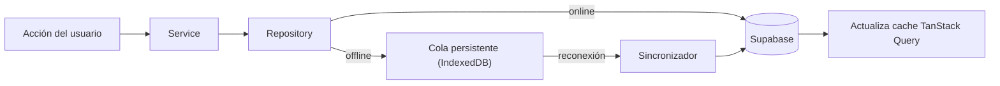

# 13 · Offline y PWA

Nexus es **offline-first**: registrar información **nunca** depende de la conexión.
La app debe sentirse nativa e instalable. Esta capa se implementa en los Sprints
14 (offline) y 15 (PWA), pero la arquitectura está preparada desde el diseño.

## Offline-first

### Preparación desde el diseño

- Los **repositorios** son la costura: escriben en Supabase con red, o en la
  **cola local** sin red. El resto de capas no sabe si hay conexión.
- Toda tabla sincronizable tiene `updated_at` (resolución de conflictos) y
  `deleted_at` (tombstones para borrados). Ver [05](./05-base-de-datos.md).
- Los ids son **UUID generados en cliente**: una entidad creada offline ya tiene
  su id definitivo y no necesita reconciliación de claves al sincronizar.

### Estrategia de cache y estado

- **TanStack Query** cachea el server state; su cache se **persiste** (para
  disponer de datos al abrir sin red).
- El **Service Worker** cachea el _app shell_ y assets (estrategia de cache
  inteligente por tipo de recurso).

### Cola de escritura offline

- Las mutaciones offline se **encolan** de forma persistente y se aplican de forma
  **optimista** en la cache (la UI responde al instante).
- Al recuperar conexión, el **sincronizador** reproduce la cola en orden.

### Resolución de conflictos

- Estrategia base: **last-write-wins por `updated_at`**.
- Borrados: **tombstones** con `deleted_at` (no se pierde el hecho de borrar).
- Casos con lógica de negocio sensible (p. ej. un `plan` recalculado) pueden usar
  reglas específicas en el service; se documentará al implementarlo.
- Nunca se pierden datos silenciosamente: los conflictos no triviales se registran
  y, si procede, se informan al usuario.

### Decisión de librería de persistencia

**Resuelta:** persister síncrono de TanStack sobre `localStorage`. Se midió la
caché real —**34,2 KB** con la pantalla más pesada abierta— y no justifica ni
IndexedDB ni una dependencia nueva. Razonado en
[ADR-0007](./adr/0007-cache-persistente-en-localstorage.md), que también explica
por qué se borra al cerrar sesión y por qué un `maxAge` de 7 días no puede hacer
pasar datos viejos por los de hoy.

## PWA

### Objetivos

Sentirse como app nativa, instalable en Android e iOS, con actualizaciones
controladas y notificaciones útiles.

### Componentes

| Pieza               | Rol                                                                  |
| ------------------- | -------------------------------------------------------------------- |
| **Manifest**        | Nombre, iconos, colores de tema, `display: standalone`, orientación. |
| **Service Worker**  | Cache del app shell, estrategia offline, actualización.              |
| **Instalación**     | Prompt de instalación (A2HS) con buen momento y UX.                  |
| **Actualizaciones** | Aviso al usuario cuando hay versión nueva; recarga controlada.       |

### Cómo está implementado

Se usa **`vite-plugin-pwa`** (Workbox por debajo) como dependencia de desarrollo:
genera el service worker y el manifiesto en el build, sin código de service
worker escrito a mano —que es donde viven los errores difíciles de este terreno—
y sin peso extra en el bundle de producción.

- **`registerType: 'prompt'`.** La versión nueva **no se aplica sola**: se avisa
  y decide el usuario (`UpdatePrompt`). Recargar por sorpresa a media serie en el
  gimnasio se lleva por delante lo que estuviera haciendo.
- **El registro vive en la raíz** (`main.tsx`), no en el cascarón. El cascarón
  sólo se monta con sesión iniciada, así que registrarlo ahí dejaba sin service
  worker a quien aún no ha entrado — justo el caso que permite abrir sin señal.
  Se descubrió probando el build servido, donde la primera pantalla es `/entrar`.
- **Nada de interceptar las llamadas a Supabase.** El service worker cachea el
  cascarón; los datos los guarda la caché de TanStack Query
  ([ADR-0007](./adr/0007-cache-persistente-en-localstorage.md)), que se borra al
  cerrar sesión. Servir datos de salud caducados desde el service worker sería
  saltarse esa garantía.
- **Desactivado en desarrollo** (`devOptions.enabled: false`): un service worker
  cacheando mientras se programa hace perder horas persiguiendo cambios que sí
  estaban.

**Iconos.** El manifiesto declara un PNG de 192 y el SVG para los tamaños
grandes, que escala sin perder nitidez y evita arrastrar más binarios; más una
variante `maskable` (fondo a sangre y la N dentro de la zona segura del 80 %).
iOS ignora el manifiesto, así que su icono va como `apple-touch-icon` en el
`index.html` y **tiene que ser PNG**. Si algún día el splash de Android pide un
PNG de 512, se genera desde `favicon.svg` con un `<canvas>` (`drawImage` sobre un
lienzo del tamaño deseado y `toDataURL('image/png')`), sin añadir dependencias.

**Comprobado de punta a punta:** con el build servido, el service worker queda
activo con 36 ficheros cacheados, y **apagando el servidor la aplicación sigue
abriendo**.

### Instalación (A2HS)

Quien decide si se puede instalar es el navegador; `useInstallPrompt`
(`shared/hooks`) sólo se entera de esa decisión y la traduce a cuatro casos:
`installed`, `ready`, `manual` (iOS) y `unavailable`.

- **El aviso del navegador se guarda en el módulo, no en un componente.**
  `beforeinstallprompt` se dispara **una sola vez** y suele llegar antes de que
  React monte nada, así que un `useEffect` llega tarde; y un listener que muriera
  con su componente perdería el aviso al salir del Dashboard, dejando la
  aplicación sin forma de instalarse hasta la siguiente visita. Hay un test que
  fija justo eso.
- **`preventDefault()` sobre el aviso.** Sin él Chromium enseña su propia barra
  cuando le parece, y el momento deja de decidirlo la aplicación.
- **Se ofrece en dos sitios y con distinto tono:** una sección permanente en
  **Ajustes**, que contesta los cuatro casos —incluido «ya está instalada», que
  es a lo que se entra a Ajustes—, y un aviso **una sola vez** en el Dashboard,
  que al descartarse no vuelve (`nexus.install-dismissed`).
- **El aviso del Dashboard sólo sale cuando hay un botón que instala de verdad.**
  En iOS habría que explicar dos toques que el usuario tendría que recordar
  mientras cierra el aviso: eso estorba, y su sitio es Ajustes.
- **iOS se explica, no se promete.** Safari no ofrece instalar por código, así
  que allí se describen los dos toques reales (Compartir → «Añadir a inicio»).
  Se detecta también el iPad de iPadOS 13+, que se hace pasar por un Mac y sólo
  lo delata la pantalla táctil.

### Notificaciones

**Aplazadas a propósito** ([ADR-0008](./adr/0008-notificaciones-aplazadas.md)).
Lo que aquí se describía son **recordatorios a una hora**, y en la web eso sólo
se consigue con **Web Push**: tabla de suscripciones, claves VAPID, una Edge
Function que envíe y un programador (`pg_cron`) que decida a quién le toca. Es un
subsistema de servidor, no el remate de un sprint de PWA. La alternativa que
parece funcionar —`setTimeout` en la página— sólo avisa con la aplicación
abierta, o sea a quien ya está mirándola.

Por eso `user_preferences.notifications_enabled`, `reminder_times` y la tabla
`notifications` **siguen sin usarse**: están previstas, no olvidadas. Cuando el
requisito aparezca de verdad, entra como sprint propio y con estos principios
intactos: ayudan y no molestan, prioridad para agua, entrenamientos, hábitos y
estudio, y el usuario controla su configuración.

### Compatibilidad

- Se contemplan las limitaciones de **iOS** (Service Worker y push más
  restringidos): se degrada con elegancia y se prioriza la instalación A2HS y el
  offline de lectura/registro.

## Definición de "Hecho" de esta capa

- Registrar datos sin conexión y verlos reflejados de inmediato. _(Sprint 14,
  parado a propósito: sólo se hizo la caché persistente.)_
- Sincronizar al reconectar **sin pérdida** de datos ni duplicados. _(Ídem.)_
- App instalable, con app shell disponible offline y actualizaciones avisadas.
  **Hecho.**
- Notificaciones configurables y no intrusivas. _(Aplazado, ADR-0008.)_
